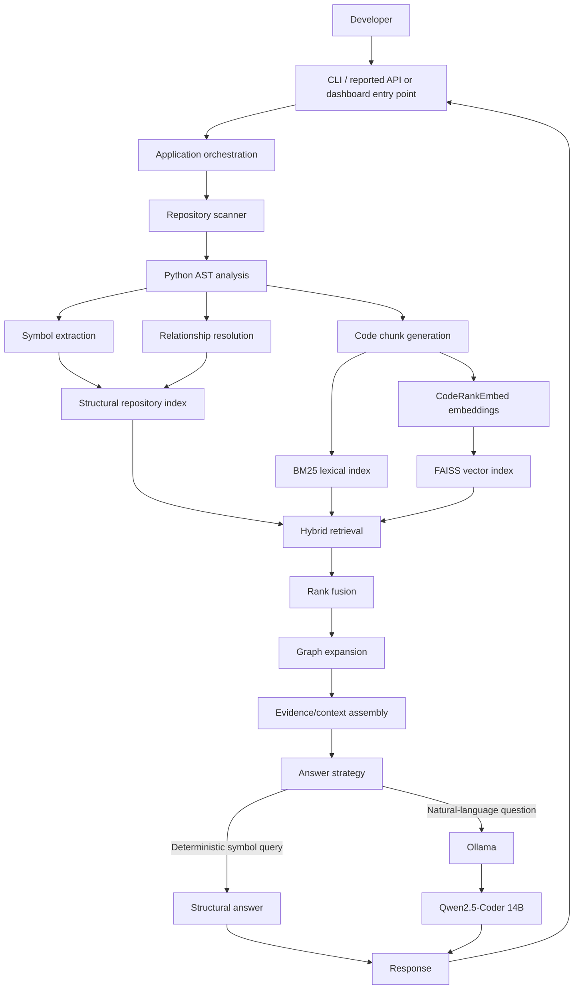
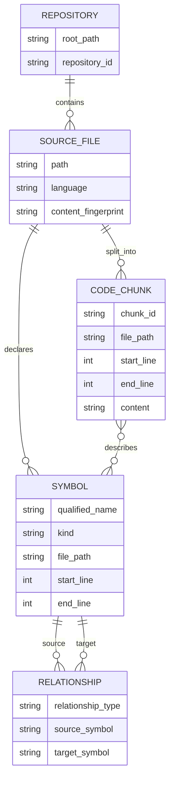
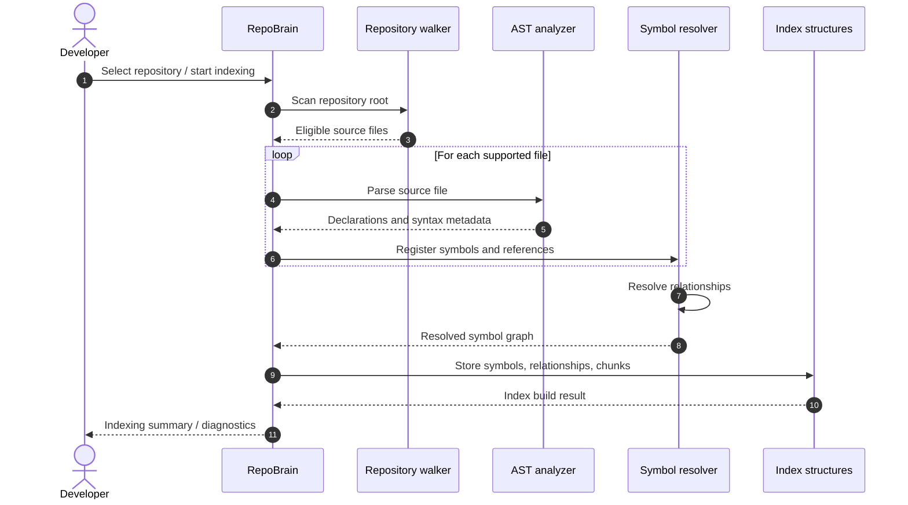
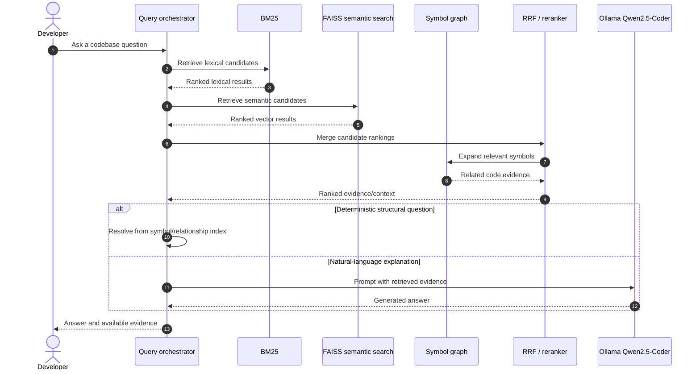
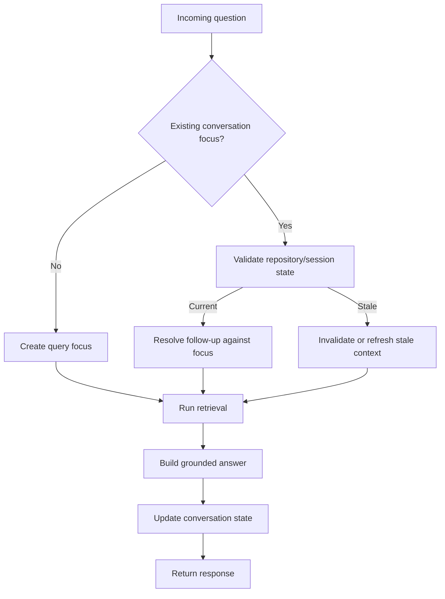
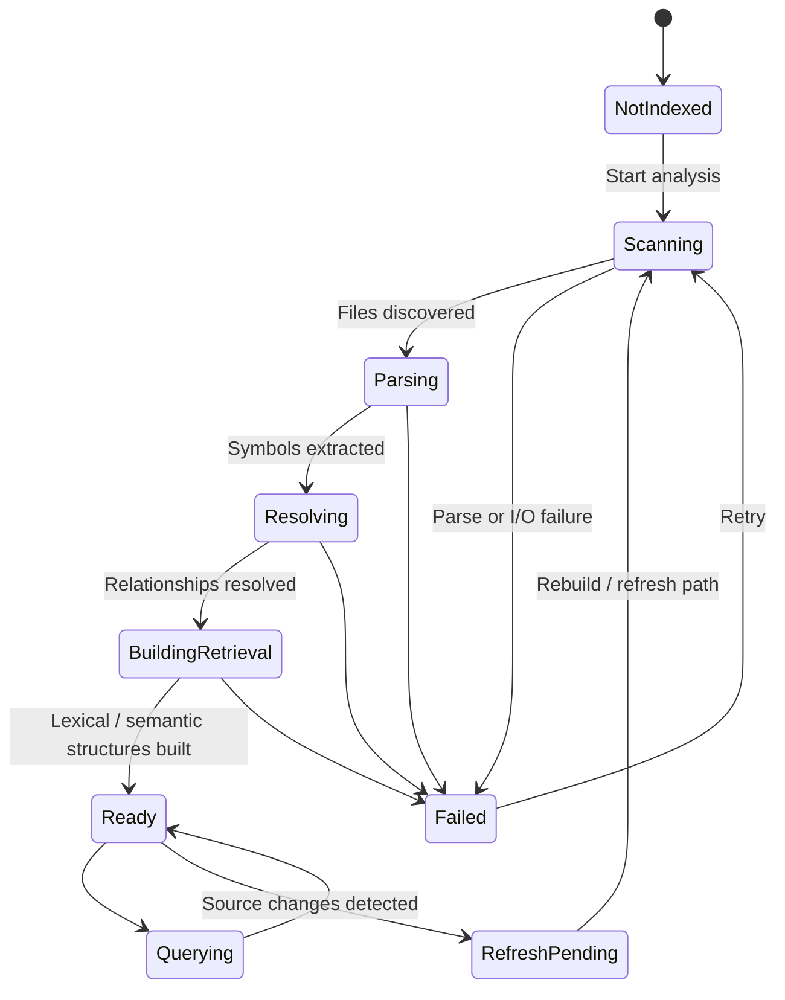
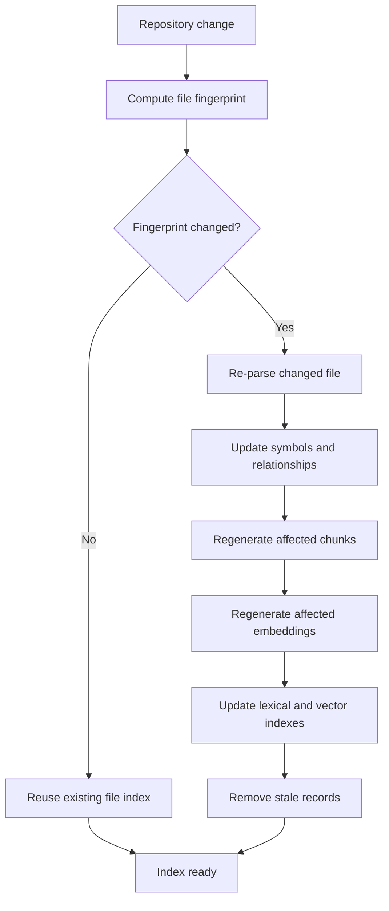

import pypandoc, os

readme = r'''# RepoBrain

> **Repository-aware code intelligence for understanding, searching, and exploring software systems.**

RepoBrain is a local-first code-intelligence project that combines structural source-code analysis with lexical, semantic, and graph-based retrieval. Its goal is to help developers ask questions about a codebase and receive answers grounded in the repository rather than relying only on a language model's general knowledge.

This document is both the project overview and the developer onboarding guide. It describes the architecture and workflows established in the project history, gives setup guidance, and separates verified capabilities from work that was planned or not yet re-verified.

---

## Documentation status and accuracy

RepoBrain has evolved through multiple implementation phases. The implementation notes available for this README establish a working Python analysis and retrieval core, but do **not** establish the current contents of every file, the current HTTP route table, or the final state of the later deployment work.

| Area | Status represented here |
|---|---|
| Python source scanning and AST-based analysis | **Verified in project history** |
| Symbol extraction and relationship resolution | **Verified in project history** |
| Chunk generation and hybrid retrieval | **Verified in project history** |
| FAISS semantic index using CodeRankEmbed embeddings | **Verified in project history** |
| Graph expansion and Reciprocal Rank Fusion | **Verified in project history** |
| Local Qwen2.5-Coder 14B through Ollama | **Verified in project history** |
| FastAPI dashboard/API | **Reported as part of the later baseline; current routes and exact UI state need re-verification** |
| Persistent indexing and incremental updates | **Roadmap / implementation target; do not assume complete** |
| File-and-line citations in generated answers | **Roadmap / implementation target; do not assume complete** |
| Docker deployment | **A Docker build and Compose workflow were attempted; a repository-opening HTTP 404 was reported. End-to-end deployment is not verified** |
| Automated evaluation suite | **Planned; do not assume complete** |

**Important:** A feature described as “planned” below is not represented as implemented. Before publishing performance claims or API examples as guarantees, verify them against the current checkout.

---

## Contents

- [1. Project goals](#1-project-goals)
- [2. Core concepts](#2-core-concepts)
- [3. Architecture](#3-architecture)
- [4. End-to-end workflows](#4-end-to-end-workflows)
- [5. Retrieval pipeline](#5-retrieval-pipeline)
- [6. Technology stack](#6-technology-stack)
- [7. Repository layout](#7-repository-layout)
- [8. Requirements](#8-requirements)
- [9. Local setup](#9-local-setup)
- [10. Configuration](#10-configuration)
- [11. Running RepoBrain](#11-running-repobrain)
- [12. API and integration contract](#12-api-and-integration-contract)
- [13. Docker workflow](#13-docker-workflow)
- [14. Testing and validation](#14-testing-and-validation)
- [15. Troubleshooting](#15-troubleshooting)
- [16. Security and operational notes](#16-security-and-operational-notes)
- [17. Roadmap](#17-roadmap)
- [18. Contributing](#18-contributing)

---

## 1. Project goals

RepoBrain is intended to make a large or unfamiliar repository easier to understand.

### What it is designed to do

1. **Inspect source code** and identify files, declarations, symbols, and relationships.
2. **Build structural context** from the language's syntax tree rather than treating source files as plain text only.
3. **Index code for retrieval** using complementary lexical and semantic approaches.
4. **Expand relevant results** through relationships such as callers, callees, and connected symbols.
5. **Use a local LLM** to synthesize an answer from retrieved repository evidence.
6. **Support follow-up questions** while retaining the current repository/question focus.

### Design principles

- **Repository-grounded:** retrieve source evidence before asking the model to answer.
- **Hybrid retrieval:** lexical matching, embeddings, and code structure each solve different search problems.
- **Local-first inference:** the recorded model integration uses Ollama and Qwen2.5-Coder.
- **Deterministic where possible:** symbol and relationship queries should not depend on free-form model reasoning when the answer can be computed from the index.
- **Inspectable:** indexing and retrieval should be diagnosable, testable, and explainable.
- **Incrementally maintainable:** persistent and incremental indexing are target capabilities, not assumptions about the current build.

---

## 2. Core concepts

| Term | Meaning |
|---|---|
| Repository scanner | Walks the selected repository and identifies eligible source files. |
| AST | Abstract Syntax Tree: a structured representation of source syntax. |
| Symbol | A named code entity such as a module, class, function, or method. |
| Relationship | A structural link between symbols, such as a call or reference. |
| Chunk | A bounded source-code segment used as a retrieval unit. |
| BM25 | Lexical ranking method that scores documents based on query-term relevance. |
| Embedding | A numeric vector representing semantic content. |
| FAISS | Vector-search library used by the semantic retrieval path. |
| Graph expansion | Enriches initial search results with connected symbols and relationships. |
| RRF | Reciprocal Rank Fusion; combines ranked result lists without requiring their raw scores to be on the same scale. |
| Ollama | Local model runtime used for LLM inference. |

---

## 3. Architecture

### 3.1 High-level system architecture

The diagram describes the established logical architecture. The web/API and persistence boundaries are shown separately because their current completion state must be checked in the checkout.



### 3.2 Component responsibilities

| Component | Responsibility |
|---|---|
| Scanner | Traverse the repository, apply file-selection rules, and read source files safely. |
| AST analyzer | Parse source files and identify syntax-level entities. |
| Symbol index | Store symbol identity and metadata for lookup. |
| Relationship resolver | Resolve references/calls between known symbols where possible. |
| Chunker | Produce source segments that can be ranked and passed as context. |
| Lexical retriever | Find exact names, identifiers, and keyword matches. |
| Semantic retriever | Find conceptually related code using embeddings and FAISS. |
| Rank fusion | Merge independent ranked lists into one candidate list. |
| Graph expansion | Add useful neighboring symbols to the candidate evidence. |
| Answer strategy | Choose deterministic structural handling or LLM synthesis. |
| Ollama client | Send grounded prompts to the locally running model. |

### 3.3 Analysis data model

The project history confirms symbol, relationship, and chunk concepts. The following is a **conceptual** model, not a claim about exact Python dataclass or database field names.



---

## 4. End-to-end workflows

### 4.1 Repository ingestion and analysis



**Recorded validation snapshot:** one historical end-to-end run reported 90 files, 710 symbols, 4,385 resolved relationships, 714 chunks, and a graph containing 710 nodes and 1,706 edges. These are results from that run, **not** guaranteed counts for every repository or the current checkout.

### 4.2 Question answering



The diagram captures the intended decision path. Exact response payloads, citation format, and UI behavior must be verified against the current API implementation.

### 4.3 Follow-up question context

The later project baseline described multi-turn focus and follow-up handling, along with caching, fingerprints, and stale-session protection.



### 4.4 Index build lifecycle

The established baseline includes index construction and content fingerprints. Persistent index storage and reliable incremental refresh are separate roadmap items until verified.



---

## 5. Retrieval pipeline

RepoBrain uses multiple retrieval signals because code search is not one-dimensional.

### 5.1 Lexical retrieval

The BM25 path is useful when a query contains exact identifiers, filenames, class names, error strings, or domain-specific terms.

Example:

- Query: `where is _calculate_sha256 used?`
- Lexical search prioritizes matching identifiers and nearby code chunks.
- The result can be enriched with symbol metadata and graph neighbors.

### 5.2 Semantic retrieval

The semantic path uses **CodeRankEmbed** embeddings with a **768-dimensional** representation and a FAISS `IndexFlatIP` index, according to the recorded Phase 3C.3 implementation.

Semantic search is useful for queries such as:

- “Where is repository traversal performed?”
- “Which function validates that a path stays inside the repository?”
- “Show code responsible for ranking search results.”

The embedding model can retrieve conceptually related code even when the wording differs from the identifier names.

### 5.3 Graph expansion

After initial retrieval, RepoBrain can use the symbol graph to add connected evidence. Depending on the question, useful neighbors include:

- callers of a function;
- callees invoked by a function;
- symbols in the same structural area;
- relationships resolved during source analysis.

Graph expansion is not a replacement for retrieval. It enriches the candidate set with structural context.

### 5.4 Reciprocal Rank Fusion

The project history records Reciprocal Rank Fusion (RRF) for combining ranked retrieval lists.

A common RRF form is:

\[
\operatorname{RRF}(d) =
\sum_{r \in R}
\frac{1}{k + \operatorname{rank}_{r}(d)}
\]

Where:

- \(d\) is a candidate document/chunk;
- \(R\) is the set of ranked result lists;
- \(\operatorname{rank}_{r}(d)\) is the candidate's rank in list \(r\);
- \(k\) is a smoothing constant.

RRF is useful because BM25 scores and vector similarity scores are not naturally on the same scale.

### 5.5 Deterministic structural answers

Some questions should be answered from the index rather than delegated to an LLM. For example, caller/callee lookups can be resolved from relationships already extracted by the analyzer. The recorded implementation specifically included deterministic caller/callee answers.

### 5.6 Historical retrieval validation

A Phase 3C.3 test snapshot recorded:

- `FAISS IndexFlatIP`;
- CodeRankEmbed, 768 dimensions;
- candidate pool of approximately 50;
- deterministic intents and reranking that preserved the original `score` field;
- `_calculate_sha256` ranked fourth in one recorded check;
- `_ensure_inside_repository` and `_walk_repository` ranked first in that check;
- 122 tests at that phase.

A later project note reported 376 tests passing in a broader baseline. Treat both as historical snapshots, not as a current test count.

---

## 6. Technology stack

| Technology | Role | Status / notes |
|---|---|---|
| Python | Core application, parsing, indexing, retrieval | Established |
| Python `ast` | Syntax parsing and symbol extraction | Established for Python source |
| BM25 | Lexical retrieval | Established |
| CodeRankEmbed | Code embedding model | Recorded semantic retrieval component |
| FAISS | Vector similarity index | Recorded as `IndexFlatIP` |
| Reciprocal Rank Fusion | Merge lexical and semantic rankings | Established in retrieval design |
| NetworkX / graph structures | Symbol relationship graph | Graph behavior is established; confirm exact graph library in current dependency files |
| Ollama | Local model serving | Established integration |
| Qwen2.5-Coder 14B | Local code LLM | Recorded model configuration |
| FastAPI | HTTP API layer | Reported in later baseline; verify current routes |
| Docker / Docker Compose | Container packaging and orchestration | Build was attempted; end-to-end run not verified |
| pytest | Automated tests | Historical test suite reported |
| Git | Source control | Development workflow |

### 6.1 Model and retrieval configuration recorded for the project

```dotenv
REPOBRAIN_REPOSITORIES_DIR=D:/repobrain
REPOBRAIN_OLLAMA_MODEL=qwen2.5-coder:14b
```

The local Ollama model is expected to be available under the configured model name. Embedding-model configuration and exact dependency versions should be taken from the current source/configuration files rather than guessed here.

---

## 7. Repository layout

The following paths are explicitly present in the recorded project structure. The layout below is intentionally conservative: it does not invent unverified modules or claim that every roadmap component already exists.

```text
repobrain/
├── repobrain/
│   └── retrieval/
│       ├── chunks.py
│       ├── lexical.py
│       ├── semantic.py
│       ├── semantic_document.py
│       ├── semantic_ranking.py
│       └── symbols.py
├── scripts/
├── tests/
├── requirements.txt
├── pyproject.toml
├── run.py
├── .env.example
├── .env                  # local only; do not commit
└── README.md
```

**Layout note:** `repobrain/retrieval/` modules above were recorded in an earlier README snapshot. The presence and names of the other top-level entries should be checked in the current checkout. The exact current tree was not available when this document was assembled.

### 7.1 Retrieval module responsibilities

| Module | Recorded responsibility |
|---|---|
| `chunks.py` | Code chunk construction / chunk-related operations |
| `lexical.py` | Lexical retrieval |
| `semantic.py` | Semantic retrieval and vector search |
| `semantic_document.py` | Semantic document representation |
| `semantic_ranking.py` | Semantic candidate ranking / reranking |
| `symbols.py` | Symbol-oriented retrieval |

---

## 8. Requirements

Use the project's pinned dependency files as the source of truth.

- Git
- Python version compatible with the current `pyproject.toml` and `requirements.txt`
- An Ollama installation if using local LLM inference
- The configured `qwen2.5-coder:14b` model pulled into Ollama
- Sufficient RAM and disk for the selected model and repository indexes

The exact supported Python version, package versions, and optional system dependencies must be read from the current project files. Do not assume that the developer's local Python version is the project's supported version.

---

## 9. Local setup

### 9.1 Clone the repository

```bash
git clone <REPO_URL>
cd repobrain
```

Replace `<REPO_URL>` with the actual repository clone URL.

### 9.2 Create and activate a virtual environment

**Windows PowerShell**

```powershell
py -m venv .venv
.\.venv\Scripts\Activate.ps1
python -m pip install --upgrade pip
```

**Linux / macOS**

```bash
python3 -m venv .venv
source .venv/bin/activate
python -m pip install --upgrade pip
```

### 9.3 Install dependencies

```bash
pip install -r requirements.txt
```

If the project is configured for editable installation through `pyproject.toml`, use the repository's documented packaging configuration. Do not install optional development extras unless they are defined in that file.

### 9.4 Configure environment variables

**Windows PowerShell**

```powershell
Copy-Item .env.example .env
notepad .env
```

**Linux / macOS**

```bash
cp .env.example .env
nano .env
```

Set the repository directory and model name using paths valid for your operating system:

```dotenv
REPOBRAIN_REPOSITORIES_DIR=/absolute/path/to/repositories
REPOBRAIN_OLLAMA_MODEL=qwen2.5-coder:14b
```

For the historical Windows development setup, the recorded repository path was:

```dotenv
REPOBRAIN_REPOSITORIES_DIR=D:/repobrain
REPOBRAIN_OLLAMA_MODEL=qwen2.5-coder:14b
```

Do not commit `.env`. Keep secrets and machine-specific paths out of version control.

### 9.5 Prepare Ollama

Install Ollama using its official installation instructions, then pull the configured model:

```bash
ollama pull qwen2.5-coder:14b
```

Start the Ollama service using the normal command for your operating system. Verify that the model is available:

```bash
ollama list
```

If RepoBrain uses a different model tag in the current `.env`, use that exact tag instead.

---

## 10. Configuration

The following environment variables are confirmed by the recorded setup notes:

| Variable | Purpose | Example |
|---|---|---|
| `REPOBRAIN_REPOSITORIES_DIR` | Root directory in which RepoBrain can access repositories | `D:/repobrain` |
| `REPOBRAIN_OLLAMA_MODEL` | Ollama model tag used for answer generation | `qwen2.5-coder:14b` |

Other settings may exist in `.env.example`, `pyproject.toml`, or the application configuration. Inspect those files before adding undocumented variables.

### Repository path safety

The historical test notes specifically mention `_ensure_inside_repository` and repository walking safeguards. Keep repository access constrained to the configured root. Do not accept arbitrary filesystem paths from untrusted clients without validating and resolving them against the allowed repository directory.

---

## 11. Running RepoBrain

The recorded project includes a root-level `run.py`. The exact supported command-line arguments and server entry point must be checked in the current version.

Start by inspecting the entry point:

```bash
python run.py --help
```

If the script does not implement `--help`, inspect its argument parser or module entry point before choosing a command.

For a FastAPI-based checkout, identify the actual ASGI application object before starting Uvicorn. Do **not** assume a module path such as `app.main:app` unless that object exists in the current tree.

Typical ASGI launch shape, only after confirming the import path:

```bash
uvicorn <verified_module>:<verified_app_object> --host 127.0.0.1 --port 8000 --reload
```

Then open the local URL printed by the server. A successful process start does not prove that repository selection, indexing, or question answering works end to end; validate each workflow separately.

---

## 12. API and integration contract

A later project summary reported a FastAPI dashboard/API baseline, but the exact route definitions and request/response schemas were not present in the available implementation record. Therefore this README does **not** invent endpoint names.

### 12.1 Generate the authoritative API reference

If the current FastAPI application exposes OpenAPI, start the verified server and visit:

- `/docs` — Swagger UI
- `/redoc` — ReDoc
- `/openapi.json` — OpenAPI schema

These are FastAPI's conventional documentation paths; they are available only if the application has not overridden or disabled them.

### 12.2 API documentation checklist

For every implemented endpoint, document:

| Field | What to record |
|---|---|
| Method and path | Exact HTTP method and route |
| Purpose | What the endpoint does |
| Authentication | Whether credentials or local-only access are required |
| Request | Exact JSON body, query parameters, and validation |
| Response | Exact response schema and status codes |
| Side effects | Whether it scans, indexes, mutates state, or calls the LLM |
| Errors | Validation, missing repository, indexing, and model errors |
| Example | A real request and response captured from the running app |

### 12.3 Expected logical operations

The following are product-level operations, **not guaranteed route names**:

1. Discover or select a repository under the configured root.
2. Start or inspect repository analysis.
3. Submit a natural-language question.
4. Retrieve symbol, caller, or callee information.
5. Inspect indexing or runtime diagnostics.

Use the actual route names and schemas from the generated OpenAPI document when integrating a frontend or external client.

---

## 13. Docker workflow

Docker support was one of the project's deployment goals. A previous development session reported that `docker compose up --build -d` completed a build/start workflow, but opening a repository returned HTTP 404. This means Docker packaging was attempted; it does **not** establish that the complete containerized application was healthy.

### 13.1 Historical command sequence

```powershell
cd D:\repobrain
Copy-Item .env.example .env
notepad .env
docker compose up --build -d
```

The historical container setup mapped the host repository directory to `/repositories` inside the container. Confirm the current `compose.yaml` or `docker-compose.yml` before relying on that mount path.

### 13.2 Container workflow

```mermaid
flowchart TD
    DEV[Developer] --> ENV[Configure .env]
    ENV --> COMPOSE[Docker Compose]
    COMPOSE --> APP[RepoBrain application container]
    HOST[Host repository directory] -->|bind mount| REPOS[/repositories in container]
    APP --> REPOS
    APP --> OLLAMA[Ollama service / configured endpoint]
    APP --> HTTP[HTTP API or dashboard]
    HTTP --> DEV
```

### 13.3 Verify the deployment

Run:

```bash
docker compose ps
docker compose logs --tail=200
```

Check the actual published port in the Compose file:

```bash
docker compose config
```

Then verify, in order:

1. The application container is running and not restarting.
2. The configured repository mount exists inside the container.
3. The application can enumerate the mounted directory.
4. The API health route, if implemented, returns a healthy response.
5. The repository-selection route returns a valid result.
6. Indexing completes without path or permission errors.
7. The configured Ollama endpoint is reachable from the application container.
8. A small repository question returns a grounded response.

### 13.4 Container networking note

Inside a container, `localhost` refers to that same container. If Ollama runs on the host or in another container, configure a reachable service address rather than assuming `localhost` will reach it. The correct hostname depends on the Compose network and operating system.

---

## 14. Testing and validation

The project history contains two test snapshots:

- **122 tests** at the Phase 3C.3 retrieval milestone.
- **376 tests passed** in a later project baseline note.

These counts are historical and should not be advertised as the current passing count until the current checkout is tested.

Run the test suite using the repository's configured test command. If pytest is configured:

```bash
pytest
```

For more detailed output:

```bash
pytest -v
```

### 14.1 Recommended validation matrix

| Layer | Validation |
|---|---|
| Scanner | Correctly discovers eligible files and excludes irrelevant paths |
| AST analysis | Extracts expected declarations from representative Python files |
| Symbol resolution | Resolves known references and handles unresolved references safely |
| Chunking | Produces bounded chunks with valid source metadata |
| Lexical search | Finds exact identifiers and distinctive terms |
| Semantic search | Retrieves conceptually related code |
| Rank fusion | Combines rankings without corrupting candidate metadata |
| Graph expansion | Adds relevant callers/callees without uncontrolled expansion |
| Deterministic answers | Returns correct caller/callee information |
| LLM integration | Handles model unavailable, timeout, and malformed responses |
| Session handling | Rejects or refreshes stale repository/session state |
| API | Validates request schemas, errors, and response contracts |
| Docker | Works with a mounted repository and reachable inference service |

### 14.2 Suggested smoke test

Use a small, known Python repository and validate the complete path:

```text
Repository path
    -> file scan
    -> AST parse
    -> symbols and relationships
    -> chunks
    -> lexical + semantic retrieval
    -> rank fusion + graph expansion
    -> deterministic answer or LLM synthesis
```

Record the input repository, file count, symbol count, relationship count, chunk count, test result, and model tag. This makes future regressions easier to diagnose.

---

## 15. Troubleshooting

### 15.1 Repository selection returns HTTP 404

A previous Docker session encountered an HTTP 404 when opening a repository.

A 404 usually means the requested route or resource was not found. It does not, by itself, prove that Docker failed.

Check:

1. **Route mismatch:** compare the frontend request URL with the routes in `/openapi.json` or the FastAPI route registration.
2. **Repository identifier mismatch:** confirm whether the API expects a repository name, ID, relative path, or another identifier.
3. **Mount path mismatch:** verify that the host directory is mounted at the path the backend expects.
4. **Configured root mismatch:** compare `REPOBRAIN_REPOSITORIES_DIR` with the actual path inside the container.
5. **URL encoding:** ensure spaces and special characters in repository paths are encoded correctly.
6. **Stale frontend build:** rebuild the frontend/container if it is calling an older route.
7. **Backend logs:** inspect `docker compose logs --tail=200` for the request path and exception.

Useful commands:

```bash
docker compose ps
docker compose config
docker compose logs --tail=200
```

Do not “fix” a 404 by changing the repository path blindly. First identify whether the missing resource is the route, repository record, or mounted directory.

### 15.2 Ollama model not found

```bash
ollama list
ollama pull qwen2.5-coder:14b
```

Check that `REPOBRAIN_OLLAMA_MODEL` matches the installed model tag exactly.

### 15.3 Ollama works on the host but not in Docker

Check the inference URL used by the container. Container-local `localhost` is not the host machine. Use a reachable host address or a Compose service name, depending on deployment topology.

### 15.4 Repository appears empty

- Confirm `REPOBRAIN_REPOSITORIES_DIR`.
- Confirm the path exists in the same environment where RepoBrain runs.
- For Docker, inspect the bind mount with `docker compose config`.
- Check file permissions and repository-walker exclusion rules.
- Try a small repository with known Python files.

### 15.5 Python files fail to parse

- Check the Python syntax and encoding of the affected file.
- Confirm the parser is running under a Python version compatible with the source syntax.
- Inspect diagnostics for the file path and parser exception.
- A single unsupported or malformed file should not silently invalidate the entire repository analysis.

### 15.6 Semantic search returns weak results

- Confirm the embedding model is available and loaded.
- Confirm the query and indexed vectors use the same embedding model and dimensions.
- Verify the FAISS index dimension (the historical implementation used 768 dimensions).
- Inspect lexical results separately to determine whether the problem is semantic retrieval or downstream fusion.
- Check candidate-pool size and reranking behavior.

### 15.7 Tests fail after dependency installation

- Activate the intended virtual environment.
- Compare installed packages with `requirements.txt` and `pyproject.toml`.
- Avoid mixing system Python packages with the project environment.
- Capture the first failing traceback and run the relevant test in isolation.

---

## 16. Security and operational notes

- Treat repository source code as untrusted input.
- Keep filesystem access confined to the configured repository root.
- Do not execute indexed repository code as part of scanning or answering.
- Do not expose a local development API publicly without authentication and network controls.
- Do not commit `.env`, access tokens, or private repository contents.
- Apply file-size, recursion, and resource limits when indexing untrusted repositories.
- Avoid logging secrets or full source snippets unnecessarily.
- Make model/network failures explicit; do not silently fabricate an answer when evidence retrieval fails.
- If repository data is persisted in a future implementation, define retention and deletion behavior.

---

## 17. Roadmap

The following items were identified as important completion areas in the project planning notes. Their presence here does not mean they are complete.

### 17.1 Product and engineering roadmap

- [ ] **FastAPI contract hardening:** verify and document all routes, schemas, status codes, and error responses.
- [ ] **Persistent indexing:** store repository index state across application restarts.
- [ ] **Incremental updates:** detect changed, added, and deleted files and refresh only affected index artifacts.
- [ ] **Source citations:** return file paths and line ranges with answer evidence, and validate that references point to the indexed revision.
- [ ] **Docker end-to-end verification:** confirm container startup, repository mounting, API access, and Ollama connectivity.
- [ ] **Automated evaluation:** create a repeatable question set with expected files/symbols and measure retrieval quality.
- [ ] **Operational diagnostics:** expose indexing state, last successful index time, errors, and model availability.
- [ ] **Documentation synchronization:** generate API docs from the running application and keep this README aligned with the actual tree.

### 17.2 Suggested incremental indexing workflow



This is a target workflow. It should be marked implemented only after persistence, deletion handling, and consistency tests pass.

### 17.3 Suggested evaluation workflow

```mermaid
flowchart LR
    DATA[Curated repository questions] --> RUN[Run retrieval]
    RUN --> RESULTS[Ranked files / symbols / chunks]
    RESULTS --> METRICS[Recall@K / MRR / latency]
    RESULTS --> REVIEW[Human answer-grounding review]
    METRICS --> REPORT[Evaluation report]
    REVIEW --> REPORT
    REPORT --> REG[Regression baseline]
```

---

## 18. Contributing

Contributions should preserve the separation between source analysis, retrieval, orchestration, and model inference.

### Recommended workflow

1. Create a focused branch.
2. Reproduce the issue or write a failing test.
3. Make the smallest change that addresses the behavior.
4. Run the relevant tests, then the full suite.
5. Update this README if architecture, configuration, or developer commands changed.
6. Include sample inputs and outputs for retrieval or ranking changes.
7. Avoid committing local indexes, model weights, repository source data, or `.env` files.

### Pull request checklist

- [ ] The change has a clear scope and description.
- [ ] Tests cover the changed behavior.
- [ ] Existing retrieval metadata and score fields remain compatible where required.
- [ ] Repository path constraints are preserved.
- [ ] Error paths are handled and observable.
- [ ] Documentation reflects actual behavior, not intended behavior.
- [ ] No secrets, local paths, or generated index artifacts are committed.

---

## Appendix A — Historical implementation milestones

This section preserves useful engineering context from earlier development notes.

| Milestone | Recorded outcome |
|---|---|
| Phase 3C.3 | Hybrid retrieval work with FAISS `IndexFlatIP`, CodeRankEmbed 768-dimensional vectors, candidate pool around 50, deterministic intents, and reranking |
| Phase 3C.3 test snapshot | 122 tests |
| Historical end-to-end repository run | 90 files, 710 symbols, 4,385 relationships resolved, 714 chunks, 710 graph nodes, 1,706 graph edges |
| Later baseline note | 376 tests passed; FastAPI dashboard/API, local Qwen2.5-Coder 14B via Ollama, multi-turn focus/follow-ups, caching, fingerprints, stale-session protection, and diagnostics were described |
| Deployment attempt | Docker Compose build/start was attempted; repository-opening HTTP 404 remained an issue in the reported session |

These milestones are historical evidence, not a substitute for running the current code.

## Appendix B — Maintainer verification before release

Before treating this README as the definitive public documentation, verify these items in the current repository:

- [ ] Confirm the default branch and clone URL.
- [ ] Confirm the exact Python version requirement.
- [ ] Confirm the current complete folder tree.
- [ ] Confirm all dependencies and versions.
- [ ] Confirm the actual `run.py` command and ASGI import path.
- [ ] Export the actual OpenAPI route table and add endpoint examples.
- [ ] Confirm whether index persistence and incremental updates are implemented.
- [ ] Confirm citation behavior and line-number accuracy.
- [ ] Run the full test suite and replace historical test counts.
- [ ] Run Docker from a clean checkout and resolve the repository-selection 404.
- [ ] Verify Ollama connectivity in the intended deployment topology.

---

**RepoBrain — understand the codebase through its structure, search, and evidence.**
'''
out = "/mnt/data/RepoBrain_MASTER_README.md"
pypandoc.convert_text(readme, "md", format="md", outputfile=out, extra_args=["--standalone"])
print(f"Created: {out}\nSize: {os.path.getsize(out):,} bytes")
